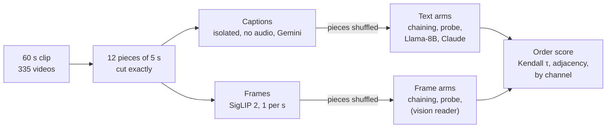

# Captions vs. frames: the new plan (unshuffling)

As of 2026-10-13. This is an export of the shared plan doc (live version: https://claude.ai/code/artifact/a0d1b4ac-8b80-42f6-8935-7183326d43a3). The pipeline diagram is reproduced as a Mermaid chart below. Revised after review the same day (no audio, on-screen text rule, matched arms, metrics, leak split), in both the live doc and this export.

## Summary

We propose to stop measuring reconstruction by **generation** (an LLM writes the missing captions) and measure it by **unshuffling** instead: cut each 60 s clip into 12 pieces of 5 s, shuffle them, and ask how much of the original order a reader can recover from captions versus from frames.

Three results drive the switch. Generation cannot be scored without the scoring choice deciding the answer. Beyond Sonnet it stops improving with a stronger model, while recognition keeps improving (51% → 77% → 85% for Haiku, Sonnet, Opus). And what the models get wrong is *when* things happen, not *what* happens, which is exactly what an ordering task measures.

The switch also forces a fix we need anyway. The existing captions were written by a model that saw the whole minute, so they leak information about the masked parts. We re-caption every 5 s piece in isolation, from the pictures only (no audio), with Gemini 3.8 Flash, for about $15–20 in total. A local open-weights text model (Llama-3.1-8B, run on Kaggle) and the frame baselines run for free; frontier models only on subsets.

## Why we are moving away from generation

Generation gives answers that depend on how we score it, does not respond to model scale, and runs on captions that leak. Each of these alone would weaken the paper; together they make generation the wrong instrument for the question.

### 1. The scoring choice decides the result

We scored the same 120 gaps (Sonnet, Opus and Llama-3.1-8B all filled them) three ways, each against the caption-copy baseline. 95% CIs from a channel bootstrap. *Per-second* rank asks for the right content at the right second. *Order-free* rank first matches the fills to the gap's seconds by the best assignment. *Segment c* scores the mean of the fills against every other non-overlapping window of the same length in the video (calibrated AUC).

| Text space (MPNet), vs. caption copy | Per-second rank (lower = better) | Order-free rank (lower = better) | Gap as a set, segment c (higher = better) |
| --- | --- | --- | --- |
| Claude Sonnet | −1.5 [−4.0, +1.2] | **−5.3** [−7.8, −2.9] | **+0.17** [+0.06, +0.29] |
| Claude Opus | −2.3 [−4.6, +0.1] | **−7.0** [−8.9, −5.3] | **+0.18** [+0.10, +0.28] |
| Llama-3.1-8B | +2.6 [0.0, +5.3] | −1.2 [−4.1, +1.6] | −0.15 [−0.27, −0.03] |

- Per-second scoring says Claude is level with copying the neighbouring caption. Order-free scoring says Claude clearly wins. Both are defensible, so the headline is a choice, not a finding.
- In frame space nothing can be measured at all: the **true** captions do not beat caption copy (segment c 0.43 vs 0.40), while frame copy reaches 0.75. When the right answer cannot beat a baseline, the metric is broken, not the model.
- A ±1–2 s tolerance does not rescue per-second scoring. It favours caption copy, whose text comes from a second inside the window.

### 2. Generation stops scaling where recognition keeps going

On **recognition** (pick which of four masked spans belongs in the gap) accuracy climbs with model size: Haiku 51%, Sonnet 77%, Opus 85% (Opus − Sonnet +8.1 points [+4.1, +12.4]). On **generation** Opus is level with Sonnet on every per-second measure in both spaces, and ahead only on order-free rank (−1.8 [−3.2, −0.4]). Generation does improve from Llama-8B to Claude (table above), but past Sonnet the model that recognizes the right span better does not write it better. Generation is measuring something other than understanding: wording, style and timing.

### 3. The failure is timing, and timing is what ordering measures

The lenient scores show Claude writes the right *content* for the gap and puts it at the wrong seconds. That is the paper's timing finding again. Generation measures it only indirectly, through a scoring choice. Unshuffling measures order and nothing else, with exact metrics (Kendall τ, adjacent-pair accuracy) and the same scorer for captions and frames.

### 4. The captions leak, so any text-vs-frames result is biased toward text

- The captioner (gemini-3-flash-preview) wrote all 60 captions in one call after seeing the whole minute, including the seconds we later mask.
- Each caption runs 1–2 s ahead of its frame, so the captions just before a gap partly describe the gap.
- 25.4% of the 20,101 captions carry an order cue ("continues" 1,668 times, "another", "again", "begins", "finishes"), although the prompt said "do not reference information from other time intervals".

This favours every text arm and no frame arm. Fixing it means re-captioning, and once we re-caption we can design the captions for a cleaner task.

### 5. Frame copy does well on recognition for the wrong reason

Frame copy picks the candidate whose frames look most like the gap's edges. It reaches 87.5%, level with Opus, because video is visually continuous, not because anything is understood: with distractors loosely matched on both captions and frames it drops to 65%, and with distractors tightly matched on frames to 35%. Unshuffling lets us control this directly, by leaving unseen gaps between the pieces so their edges are harder to match.

### 6. Generation is expensive where it matters

Frontier models run on a Claude subscription, about 4.8k input tokens per call, one call per gap. Unshuffling needs one frontier call per puzzle, a few per video and caption set, and the main text arm (Llama-8B, local on Kaggle) and the frame baselines cost nothing.

## The new task: unshuffling

Each clip becomes a jigsaw puzzle of 5 s pieces; a reader gets the pieces in random order and must put them back. We compare how much order a reader recovers from captions versus from frames, on the same pieces.

**Puzzle versions**, all cut from one captioning pass:

| Version | Pieces | What it tests |
| --- | --- | --- |
| Contiguous | all 12 pieces, 0–60 s | order including visual continuity: piece edges can be matched |
| Contiguous, half | pieces 0–5 or 6–11 | control for the gapped version: same number of pieces, no gaps |
| Gapped | every other piece (6 pieces, 5 s unseen between them) | order with edge matching weakened: edge frames are 6 s apart, so readers must rely more on how events unfold |

The gap length is the knob that moves the task from continuity toward causal order. It weakens continuity rather than removing it (a slow drone flight still looks alike 6 s later), and a 60 s clip limits how far it can turn: a 10 s gap would leave only 4 pieces. The result we hope for is that pixels win on the contiguous version and the advantage shrinks or reverses on the gapped one. That would follow from the design alone if only the text side had a reader, so the arms are matched across modalities.

**Arms**

- **Text, local (open weights, run on Kaggle) and free:** Llama-3.1-8B reads the isolated captions. It scores candidate orders from pairwise likelihoods rather than writing a permutation, as in the PMI scoring we used for forced choice.
- **Text, frontier, on a subset:** Claude (Sonnet, maybe Opus) on the same captions through the blind runner.
- **No reader, both modalities:** chain pieces by similarity: SigLIP 2 similarity of edge frames (the unshuffling analogue of frame copy) or of mean piece embeddings, and MPNet similarity of captions (the analogue of caption copy). Best path by exact search.
- **Learned order probe, both modalities:** a regression from one piece's embedding (frames or caption) to its position in the clip, trained on other channels. It sees one piece at a time, so it cannot match edges; what it gets right is knowledge of what tends to come earlier or later.
- **Frames, with a reader (optional):** a vision model on a few frames per piece, on a subset.

**Metrics:** Kendall τ (global order), adjacent-pair accuracy (local order: are true neighbours placed next to each other?) and exact-position accuracy, per video, with confidence intervals from a bootstrap over the 40 channels. Global and local metrics can rank the arms differently (a chain that is right in two halves but swaps them has τ ≈ −0.1), so the primary metric is fixed in a pre-registration before the pilot is scored. Pairwise order accuracy is not reported separately: for a full ordering it equals (τ + 1)/2.

**How it relates to what we have.** Forced choice ("recognition") is unshuffling with one slot. The Haiku/Sonnet/Opus scaling result stays in the paper as that special case.

**Where the novelty is.** Ordering itself is well studied: frame and clip order learning (Shuffle & Learn, OPN), the arrow of time, sentence and story ordering (ROCStories, SIND), and recent benchmarks showing video LLMs often ignore frame order. Our contribution is the comparison: on the same clips, how much of a video's order is recoverable from language versus pixels, and which kinds of events make the difference. The 34 forced-choice items where Opus and frame copy disagreed already point at the answer: pixels win on continuity, text sometimes wins on state changes (a fire catching, a tree becoming logs, a person sitting down). Leaving gaps between pieces to stop edge matching is itself a known device in jigsaw-style self-supervised learning (to be confirmed by the literature review); what is new is turning the gap into a graded knob for the language-vs-pixels comparison. The closest prior comparisons are probably on image or step sequences rather than video (Sort Story on SIND, sequencing multimodal instruction manuals); the literature review checks them.

**Orderability as a measure.** Some videos have no recoverable order (weaving, storms, drone fly-overs). Rather than noise, how much order a reader recovers on a video is a measure of how predictable its events are, which is the paper's original question. It is defined by one pre-specified arm, not by the best over arms, because a maximum of noisy values is biased upward. Per-video τ is noisy (SD ≈ 0.22 with 12 pieces and no signal), so its reliability is checked first: each video has two gapped puzzles with no pieces in common.

Both modalities get the same shuffled pieces, matched arms and the same scorer; the in-context and original captions (not drawn) go through the text arms only, to measure the leak.

## Leak-free captions: 5 s pieces captioned in isolation

Every piece is captioned by a model that sees only that piece and is not told where it comes from, so its caption cannot carry information from the rest of the clip. Cleaning the existing captions is not enough: removing words like "continues" does not remove knowledge of the plot ("he chops the trunk into sections" versus "a man swings an axe at a log").

**Two captioning conditions, same model, same instructions, same output format** (one description of at most 45 words per piece):

- **Isolated:** one call per piece. This is the main data for the unshuffling study.
- **In-context:** one call per video, the model sees the whole minute and describes each of the 12 pieces. It exists only to measure the leak. If readers order in-context captions better than isolated ones, the difference is the *context advantage*: the leak plus whatever the captioner gets right from seeing the whole minute (in piece 1 below, the in-context caption is the correct one). In-context captions with the cue words removed split the explicit cue words from the rest.

**Prompt design.** The prompt asks for what happens in the piece (what people, animals or machines do, or how the scene or camera changes), then the details that set the moment apart (setting, key objects, on-screen text). It does not transcribe subtitles, clocks, timestamps, dates or numbering such as day or step numbers, which would hand the text readers an order the frame arms cannot use. It describes what is seen, not heard: narration often states the order, and the frame arm cannot hear it. A prompt instruction alone does not ensure this, so the audio track is removed before upload. We deliberately do **not** tell the captioner to avoid inference. Inference from inside the piece (time of day from the light, an intent from a visible tool) is fair, and narrative inference is the ability the readers are tested on. Isolation, not the prompt, removes outside information. Prompts: `prompts/yt_video_processing/piece_isolated.txt` and `piece_in_context.txt`.

**First examples (Stage 1, gemini-3.8-flash, `Joe-Robinet_9-clip-2`).** These were captioned with audio and before the on-screen text rule; Stage 1 is being redone.

| Piece | Isolated | In-context |
| --- | --- | --- |
| 7 (35–40 s) | "A man stands beside an overturned canoe and a green tarp shelter at a forest campsite. He looks up at the trees and sky before looking down to adjust his waistband." | "The man **continues** adjusting gear on his belt, glancing up at the sky and surrounding trees as clouds pass overhead." |
| 3 (15–20 s) | "A close-up of a person's bare feet resting on camouflage fabric cuts to a wide shot of them sitting in a green tent … putting on socks" | "The camera **lingers on** the bare feet before cutting to a wide shot of the campsite …" |
| 5 (25–30 s) | "A man stands up outside his small tarp tent … and adjusts a knife on his belt." | "The man stands up from the tent and adjusts his pants …" |

"Continues" and "lingers on" only make sense if the captioner saw the previous piece. Words that describe a change inside the piece ("stands up") are legitimate: both before and after are visible, to frames as well.

**What isolation does not fix.** Isolated captions can still be wrong: in piece 1 the isolated caption has a person zipping a tent door that is never touched (we checked the frames), while the in-context caption is correct. They also repeat the whole setting in every piece. Both are measured in the pilot.

## Plan and status

We go up in small, checked steps; nothing larger runs until the step before it has been read by hand. Stage 1 is being redone without audio and is waiting on billing.

| Stage | What | Size | Status |
| --- | --- | --- | --- |
| 0. Smoke test | One isolated piece, check auth, model, output format | 1 call | Done |
| 1. Two videos | `Joe-Robinet_9-clip-2` (a person acting) and `4k-Relaxation_4-clip-4` (scenery), both conditions, read by hand + SigLIP retrieval check | 26 calls | 10 of 26 were done with audio before the free-tier limit stopped them (see Cost); set aside, all 26 to be redone without audio |
| 2. Pilot | 30 videos from 30 different channels, both conditions | 390 calls | Not started |
| 3. Unshuffle pilot | Matched text and frame arms (similarity chaining, order probe, Llama-8B) on the pilot pieces, all three puzzle versions; captions: isolated, in-context, in-context with cue words removed, original, original with cue words removed | local and Kaggle, free | Not started |
| 4. Full run | All 335 videos, then Claude on a subset | ~4,355 Gemini calls | After Stage 3 |

**Decisions made from the pilot (Stage 3):**

- **Leak size:** in-context vs isolated ordering, split into explicit cue words (in-context vs in-context with cue words removed) and the rest (in-context with cue words removed vs isolated, with caption accuracy as a covariate). A clear gap confirms the leak and is itself a finding for the paper.
- **Is removing cue words enough?** If in-context captions with cue words removed order no better than isolated ones, the leak is in the words, and cleaning the old captions is a reasonable fix for the existing generation results. If they order better, the leak runs deeper than the words. The original captions are reported alongside but don't decide this: they differ in model, length and the 1–2 s lead.
- **Does the task have signal?** If text and frames both reach near-perfect τ on the contiguous version, or neither beats chance on the gapped one, we adjust piece length or gap before the full run (a new piece length means re-captioning the pilot, about $1.50).
- **Is orderability reliable per video?** If a video's two gapped puzzles disagree too much, orderability is reported per channel or event category rather than per video.
- **Freeze:** model, prompts and puzzle versions are frozen and committed before Stage 4.

## Cost and infrastructure

The whole re-captioning costs about $15–20 at the prices we assume, inside the $60 of Google Cloud credits available ($10 redeemed so far). Measured token counts come from the Stage 1 calls (made with audio; re-measured when Stage 1 is redone); prices are from third-party listings and still need checking against the billing report.

| Call | Tokens per call (measured) | Cost per call | Pilot (30 videos) | Full (335 videos) |
| --- | --- | --- | --- | --- |
| Isolated piece | ~590 in, ~900 out (mostly thinking) | ~$0.003 | 360 calls, ~$1.10 | 4,020 calls, ~$12 |
| In-context video | ~5,800 in, ~3,100–3,700 out | ~$0.013 | 30 calls, ~$0.40 | 335 calls, ~$4.50 |

Assumed prices: $0.50 per million input tokens, $3 per million output tokens including thinking.

- **Model:** `gemini-3.8-flash`, a stable (non-preview) release. Temperature 0.8, dynamic thinking, seed 0x5EED, 1 frame per second, the same settings as the original captions, except that the audio track is removed.
- **Runner:** `scripts/caption_pieces.py`. Uses only the paid key, removes the audio track, stops at a dollar cap summed over a call log, retries Google's unbilled overload errors, resumes where it stopped, and saves the model version and a prompt hash with every output.
- **Blocker:** the key's project is still on Google's free tier (20 requests per day per model), so the credits are not yet being used. The project has to be linked to the billing account that holds the credits.
- **Routes ruled out:** the Gemini CLI no longer accepts Google AI Pro logins (replaced by the Antigravity CLI in June 2026), and the free tier is too slow. Google's Batch API would halve the cost but loses the per-call controls; worth it only for much larger runs.
- **Free arms:** Llama-3.1-8B (open weights, on Kaggle), SigLIP 2, MPNet and the order probes run locally. Claude runs only on subsets, on the subscription, after a small pilot.

## Risks and open questions

The main risk is that the comparison, not the task, has to carry the paper; the rest are design choices the pilot can settle.

| Risk or question | Why it matters | How we handle it |
| --- | --- | --- |
| Novelty | Ordering is an old task; reviewers may see "another ordering benchmark" | Frame the paper around language vs pixels on the same clips, the continuity-to-causal knob, and which events text recovers |
| Reader on one side only | If only the text side has a reader, "pixels lose on the gapped version" follows from the design | Matched arms in both modalities (similarity chaining, learned order probe); a vision reader on a subset if affordable |
| Metric choice | Global (τ) and local (adjacency) order can rank the arms differently, the same trap as scoring generation | Primary metric fixed in a pre-registration before the pilot is scored; both reported |
| On-screen text | Clocks, dates, step numbers and subtitles give the text arm an order the frame arms cannot use | The prompt says not to transcribe them; the caption check flags any that slip through |
| Isolated captions hallucinate or repeat the setting | Noise or uninformative captions lower the text arm for reasons unrelated to understanding | Measure in the pilot (SigLIP retrieval, manual reading); tighten the prompt once, before the freeze |
| Task too easy or too hard | Contiguous pieces may be solved by edge matching; gapped ones may be at chance | Three puzzle versions; adjust piece length or gap after the pilot |
| Llama-8B cannot output a permutation reliably | The free text arm may fail on format, not understanding | Score candidate orders by likelihood (as with PMI in forced choice), or use pairwise judgments |
| Captions from one model family | Gemini writes the captions; findings may be partly about Gemini's style | State it as a limitation; optionally re-caption a subset with a second model |
| No audio | Narration would leak order, but some events are only audible | Visuals only: the audio track is removed before captioning, for symmetry with the frame arm; stated in the paper |
| Google capacity | 3.8 Flash returned many "high demand" errors on the free tier | Expected to ease on the paid tier; otherwise a less loaded stable model or batch |

**For partners to decide:**

- [ ] Agree to drop generation as the headline and keep it as a short negative result in the paper
- [ ] Agree to unshuffling with isolated 5 s captions as the main study
- [ ] Approve the re-captioning budget (about $20, from existing credits)
- [ ] Choose which frontier models get a subset run (Sonnet only, or Sonnet and Opus)
