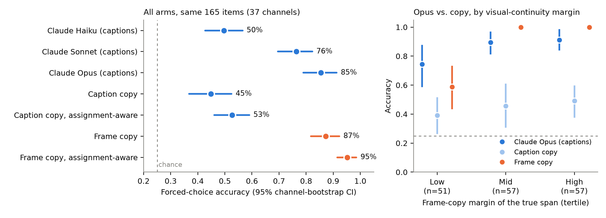
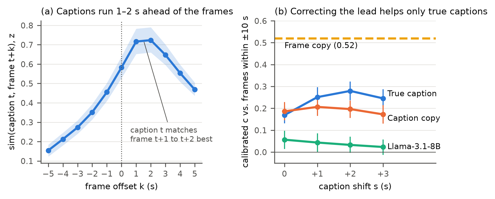
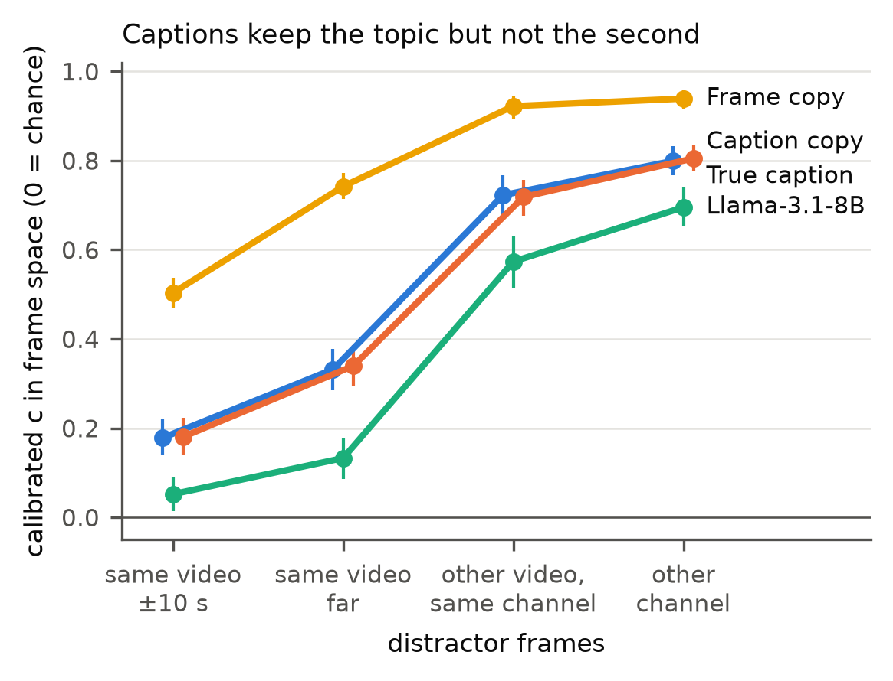
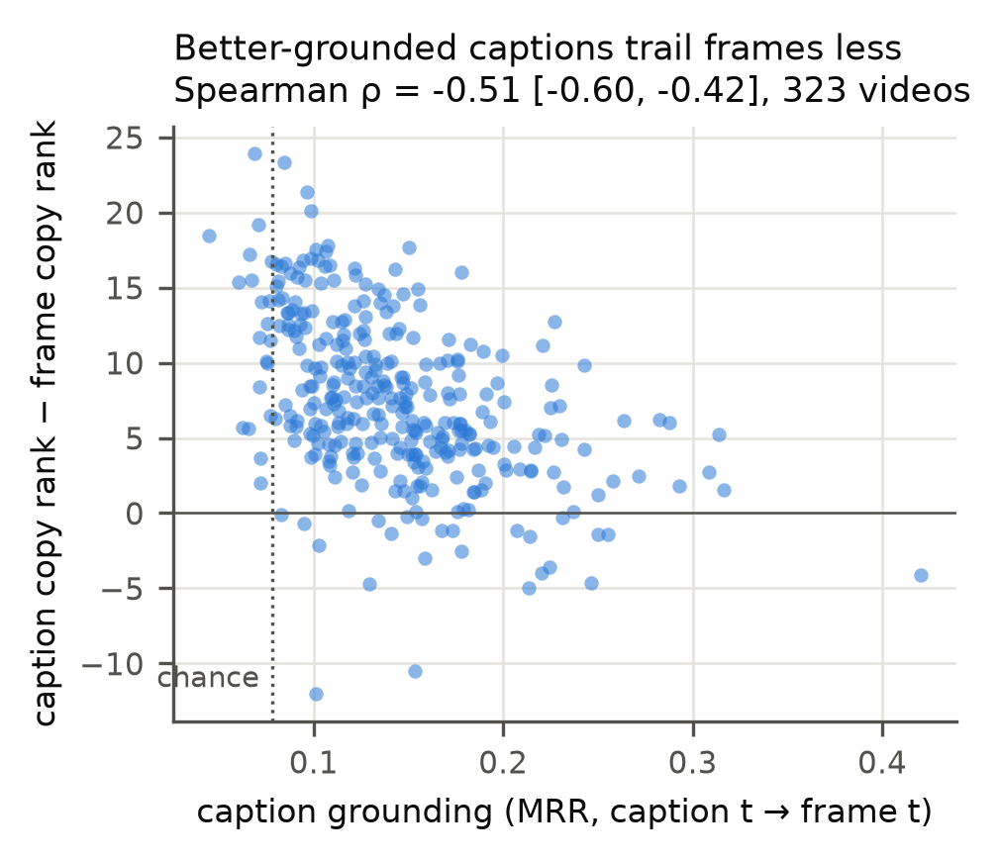

# Caption reconstruction vs. visual baselines: what we found and what we have

Status report, 14 October 2026. This is an internal summary of every result we have, not a paper draft. Each section opens with its bottom line; the detail below it is there for reference. Every confidence interval is a 95% bootstrap that resamples YouTube channels (the clips are not independent within a channel), unless stated otherwise.

---

## 0. Executive summary

> **Bottom line.**
> - **Generation (an LLM writes the missing captions) never clearly beats the simple baselines** under strict per-second scoring. Llama-3.1-8B loses to copying the nearest caption. Claude Sonnet and Opus draw level with caption copy in text space and lose to it in frame space. They clearly beat it only under lenient scoring that ignores *when* within the gap the content goes. We keep strict scoring as the primary measure, because lenient scoring works only in text space, so it cannot compare text with frames, and it drops the timing that the captions lose (§3.3).
> - **Recognition (pick which of 4 candidate spans belongs in the gap) is where language reasoning shows real strength.** Accuracy grows with the reader: Haiku 50%, Sonnet 76%, Opus 85%, against 45% for caption copy (chance 25%). Opus is statistically level with frame copy (87%), from captions alone.
> - **Where visual continuity does not single out the right span, Opus does better than frame copy** (75% vs. 59% on the third of items with the smallest visual margin). This is suggestive, not significant: +16 points [−5, +36] on 51 items.
> - **Why generation fails:** the Gemini captions keep a video's *topic* but lose its *timing*. They are only loosely tied to their own second, they run 1–2 s ahead of the frames in 39 of 40 channels, and their second-to-second changes are unrelated to the frames'. Per-frame captions from a small model do carry timing, so the loss is in these captions, not in the encoder.
> - **Main caveat:** the captions were written by a model that saw the whole minute, including the seconds we later mask. That favours every text arm. Results where text loses are therefore safe; results where text wins need a leak control we have not run.
> - **The pivot (unshuffling, with re-captioned pieces) has a pilot but no publishable result.** For every Claude model, frames gave more order than captions, which contradicts the plan's central bet.
> - **What we could still do quickly:** a leak-controlled rerun of Opus on recognition, Opus on more low-continuity items, and Opus reading frames on the same items (a real visual reader).

---

## 1. The question and the setup

> **Bottom line.** We mask a contiguous gap of W seconds in the middle of 60-second clips and ask how well it can be recovered from the surrounding **captions** (text arms) versus the surrounding **frames** (visual arms). Data: 335 clips from 40 YouTube channels (WildQA), one Gemini caption per second, SigLIP 2 embeddings of one frame per second.

**Data.**
- **Videos:** the dev (100 clips, "wild4") and test (235 clips, "wild5") splits of WildQA (Castro et al., COLING 2022), the first 60 s of each. These are outdoor, in-the-wild YouTube videos from five domains: agriculture, geography, human survival, natural disasters, and military. The 335 clips come from 40 channels, and statistics are clustered by channel.
- **Captions:** `gemini-3-flash-preview` wrote 60 captions per clip, one per second, in a single call that saw the whole minute at 1 fps (temperature 0.8, thinking on). In total there are 20,101 captions. The prompt asked for self-contained captions describing "what is visible during that 1-second interval".
- **Frames:** one frame per second (checked against exact-time extraction: offset 0 in 16 of 16 checks), embedded with SigLIP 2 base (`vit_base_patch16_siglip_224.v2_webli`, 768 dimensions). Captions are mapped into the same space with the matching SigLIP 2 text tower.
- **Text-to-text comparisons** use MPNet sentence embeddings (`all-mpnet-base-v2`).

**Masking.** The gap starts at second 29, with W ∈ {1, 2, 3, 4, 6, 8, 12, 16} seconds. Widths above 16 were dropped because long prompts truncated.

**Arms.**

| Arm | Sees | What it does |
|---|---|---|
| Llama-3.1-8B (local) | captions around the gap | writes one caption per missing second (prompt `prompts/dense_window/`, temperature 0.6, repetition penalty 1.05) |
| Claude Haiku / Sonnet / Opus 5.5 (subscription, `claude -p`, no tools, one isolated session per item) | captions around the gap | same prompt as Llama (generation), or picks a candidate (recognition) |
| Caption copy | captions | fills each missing second with the nearest unmasked caption |
| Caption mean | captions | the mean embedding of the two captions at the gap's edges |
| Frame copy | frames | fills each missing second with the nearest unmasked frame embedding |
| Frame mean | frames | the mean of the two boundary frame embeddings |

The frame arms are not a competing *method*, because they see frames the text arms never see. They measure how much a video's own visual continuity gives away for free. We have no learned visual method (no video prediction or interpolation model); see §7.

**Metrics.**
- **Per-second rank:** the rank of the true second's embedding among the video's 60 seconds (chance 30.5; lower is better). MRR is the mean reciprocal rank.
- **Calibrated AUC:** c = 2·AUC − 1 of the true target against a pool of distractors (0 = chance, 1 = perfect). The choice of pool decides what is tested (§5).
- **Forced-choice accuracy** (chance 25%), §4.
- We avoid raw cosine similarity. It correlates with how repetitive a video's captions are (Spearman ρ = +0.61 with caption self-similarity), which makes it a confound rather than a score.

---

## 2. What happened to the original hypotheses

> **Bottom line.** All three original hypotheses failed or were explained away. An LLM does not beat persistence. It does not do better in "procedural" domains. The apparent domain differences track how fast the scene changes, not how scripted the events are.

The first framing (Oct 5 draft, `docs/paper/draft.md`) asked: *when a span of video is hidden, does an LLM reading the surrounding captions recover it better than assuming persistence, and is that advantage larger in procedural domains?*

- **H1, beyond persistence: rejected.** Copying the nearest caption beat Llama in every domain and at every width except W = 1 (§3.1).
- **H2, procedural advantage: rejected.** The LLM's lift over caption copy did not differ between procedural (military) and stochastic (nature and scenery) domains (channel-clustered regression, p = 0.30).
- **H3, scene-change rate as the rival explanation: supported.** A cross-modal sensitivity measure separated military from nature clips in both splits. That separation was largely mediated by the physical scene-change rate, and controlling for it made the domain effect non-significant (p = 0.086).
- **Horizon effect.** As W grows from 3 to 12, Llama's win rate against frame copy rises from 20% to 39%. That is not because Llama improves (its MRR stays near the floor, 0.119 → 0.083). Frame copy collapses toward chance (MRR 0.175 → 0.092), because frames decorrelate over 12–16 s.
- **One sliver of text advantage.** Under high visual disagreement between the two gap boundaries (scene changes), Llama's win rate against frame copy doubles, from 8% to 17%. Frame copy still wins most of the time.

That draft predates the SigLIP 1 bug fix (§9) and also misdescribes how the captions were made. H1 and H2 rest on MPNet text-space ranks, which the bug did not affect, and H1 is confirmed by the current 335-video results in §3.1. H3's cross-modal index (the text arm's rank minus the visual arm's rank, normalized) was not recomputed after the fix, so treat H3 as provisional.

---

## 3. Generation: writing the missing captions

> **Bottom line.** Under strict per-second scoring, no text arm beats caption copy. Llama-3.1-8B loses to it (27.4 vs. 23.5 mean rank, chance 30.5). Claude Sonnet and Opus are level with it in text space and worse in frame space. Opus writes no better than Sonnet. Under lenient scoring (content right, position inside the gap ignored), Claude clearly beats copy in text space, while Llama does not. We report both, but lenient scoring cannot replace strict scoring: it has no working frame-space version, so it cannot answer the text-vs-frames question, and it removes the timing component on which the captions fail (§3.3). Because the generation headline then depends on a scoring choice, we stopped treating generation as the main instrument.

### 3.1 Llama-3.1-8B on all 335 videos

Each arm is scored in its own space: text arms in MPNet against the true caption, frame arms in SigLIP 2 against the true frame. The score is the rank of the true second among the video's 60 (chance 30.5; lower is better).

| Arm | W=1 | 2 | 3 | 4 | 6 | 8 | 12 | 16 | mean |
|---|---|---|---|---|---|---|---|---|---|
| Llama-3.1-8B | 23.0 | 26.3 | 27.5 | 27.4 | 27.6 | 28.0 | 29.5 | 30.2 | 27.4 |
| Caption copy | 23.4 | 23.1 | 22.3 | 22.7 | 22.7 | 23.5 | 24.4 | 25.6 | 23.5 |
| Caption mean | 22.7 | 22.6 | 22.8 | 23.0 | 24.1 | 25.4 | 27.1 | 28.6 | 24.5 |
| Frame copy | 7.4 | 8.2 | 10.3 | 11.1 | 13.7 | 14.9 | 17.6 | 19.5 | 12.8 |
| Frame mean | 6.9 | 8.9 | 10.8 | 12.4 | 15.5 | 17.6 | 21.3 | 23.9 | 14.7 |

- Llama trails caption copy by 3.9 ranks [3.1, 4.8] and beats it in only 32% of videos. It ties at W = 1 (23.0 vs. 23.4), where a single missing second sits between two known ones, and drifts toward chance as the gap widens.
- Caption copy trails frame copy by 10.6 ranks [9.3, 12.0] and beats it in 9% of videos.
- Llama's ordering of the seconds *within* a gap is at chance (calibrated c ≈ 0), so a fill with the right content in the wrong order scores as wrong.

### 3.2 Claude Sonnet and Opus

Same prompt as Llama. Sonnet ran on 50 videos from 28 channels × W ∈ {1, 4, 8, 16} (199 valid of 200). Opus ran on the first 32 of those videos (126 items, all valid). Haiku ran only in a 4-item pilot.

| 50 videos, 191 gaps that all arms filled (mean rank; chance 30.5) | MPNet text rank | SigLIP 2 frame rank |
|---|---|---|
| Llama-3.1-8B | 27.1 | 28.9 |
| Claude Sonnet | 22.3 | 25.8 |
| Caption copy | 23.6 | 22.5 |

- Sonnet beats Llama in text rank (−4.8 [−6.7, −2.9]) and in frame rank (−3.1 [−5.4, −1.0]).
- Sonnet only draws level with caption copy in text rank (−1.4 [−3.0, +0.5]) and is *worse* in frame rank (+3.3 [+1.5, +5.1]).
- **Opus (120 gaps) is level with Sonnet** in both spaces: text rank −0.7 [−2.7, +1.0], frame rank −0.1 [−1.4, +1.2]. Against caption copy it is borderline better in text rank (−2.3 [−4.6, +0.2]), almost all of it at W = 1, and worse in frame rank (+2.6 [+0.9, +4.4]).
- Part of the frame-space deficit may be stylistic: caption copy reuses Gemini's own wording, Claude's fills do not.

### 3.3 Lenient scoring changes the answer

Per-second rank demands the right content at the right second. Two lenient scores on the same 120 gaps:
- **Order-free rank:** match the fills to the gap's seconds by the best assignment, then rank.
- **Segment c:** score the mean of the fills against every other non-overlapping window of the same length in the video (calibrated AUC).

| Text space (MPNet), difference vs. caption copy | per-second rank | order-free rank | segment c |
|---|---|---|---|
| Claude Sonnet | −1.5 [−4.0, +1.2] | **−5.3 [−7.8, −2.9]** | **+0.17 [+0.06, +0.29]** |
| Claude Opus | −2.3 [−4.6, +0.1] | **−7.0 [−8.9, −5.3]** | **+0.18 [+0.10, +0.28]** |
| Llama-3.1-8B | +2.6 [0.0, +5.3] | −1.2 [−4.1, +1.6] | −0.15 [−0.27, −0.03] |

Ranks: negative is better. Segment c in absolute terms: caption copy 0.32, Sonnet 0.51, Opus 0.52.

- **Claude writes the right content for the gap but places it at the wrong seconds.**
- **Frame space cannot grade caption generation at all.** The *true* captions do not beat caption copy there (segment c 0.43 vs. 0.40), while frame copy reaches 0.75. When the right answer cannot beat a baseline, the metric has no headroom.
- A ±1–2 s tolerance on per-second rank does not help. It favours caption copy, whose text belongs to a second inside the tolerance window.
- Opus beats Sonnet only on order-free rank (−1.8 [−3.2, −0.4]).

**Why lenient scoring is not the primary measure.** The lenient result is real: Claude does write the right content for the gap. It still cannot be the headline, for three reasons.
1. **It cannot compare text with frames.** In frame space, even the true captions do not beat caption copy (above), so a lenient frame-space score does not separate caption arms. Where it does give a number, frame copy wins by a wide margin (segment c 0.75 vs. 0.34 for Sonnet and 0.36 for Opus). The lenient win exists only in text space, where the frame arms cannot be scored. It therefore does not bear on the question of the study.
2. **It removes the part that fails.** Reconstruction asks what happened *and when*. §5 shows that timing is exactly what the captions lose. A score that ignores position within the gap hides that finding instead of measuring it.
3. **Order-free rank is biased toward varied fills.** The best assignment is a maximum over all orderings of the fills. It cannot help caption copy, which repeats one or two boundary captions, while any set of distinct fills gains from it, and the gain grows with W. We have not calibrated this against a null (for example, distinct fills taken from another gap). Llama's non-significant −1.2 shows that the bias alone does not produce a win, but it inflates the size of Claude's.

Strict and lenient scores together say "right content, wrong seconds". Neither makes generation a fair text-vs-frames comparison. Forced choice (§4) does.

### 3.4 Downstream QA (WildQA questions)

We also tried to show utility downstream. The idea was to retrieve the evidence span for a WildQA question from a reconstructed index. Reconstruction beat repeat in MPNet (MRR 0.237 vs. 0.137, 176 questions), but Llama text from a *different gap of the same video* scored the same (0.238). So the gain is the video's topic, not the gap's content. The underlying issue is that **WildQA questions are about the whole video**: even the oracle has almost no headroom (frames 0.707, MPNet 0.671, chance 0.611 in a symmetric 3-candidate design). This line was dropped.

---

## 4. Recognition: forced choice between candidate spans

> **Bottom line.** This is the one evaluation where language reasoning clearly breaks the text baseline, and it scales with the model.
> - On the same 165 items, Opus reads captions to 85% accuracy, Sonnet 76% and Haiku 50%. Caption copy gets 45% and frame copy 87% (chance 25%).
> - Llama-3.1-8B, scored by log-probability, gets 35%.
> - Frame copy's "assignment-aware" variant gets 95%, so the frames still hold more than Opus extracts from text.
> - On the third of items where visual continuity barely singles out the right span, Opus beats frame copy by 16 points, but the CI includes 0.

### 4.1 The task

Each item masks the gap plus three distractor spans of the same width elsewhere in the clip. A method sees the masked context and the four candidate spans (each the true caption sequence of one masked span), and picks the one that belongs in the gap (chance 25%). Widths are W ∈ {1, 2, 4, 8}, giving 1,325 items.
- **Copy baselines** pick the candidate most similar to the gap's boundary captions (MPNet) or boundary frames (SigLIP 2).
- **Assignment-aware copy** also subtracts each candidate's best fit to the boundaries of the *other* masked spans, so a candidate that fits another slot better is penalized. This uses the jigsaw structure that the Claude prompt did not mention.
- **Llama** scores each candidate by pointwise mutual information (log-prob in the gap given the context, minus log-prob without context), fixed before running.
- **Claude** answers with a letter. The four candidates are in a seeded random order, and nothing tells the model that the other candidates belong to the other masked spans ("no-hint" prompt).

We call this **recognition**, as opposed to **generation** (§3).

### 4.2 Results

*Left: every arm on the same 165 items (140 videos, 37 channels). Right: Opus, caption copy and frame copy by tertile of frame copy's margin (true span's boundary similarity minus the best distractor's). The cut points are fixed over all 1,325 items. Frame copy is 100% in the middle and top tertiles by construction, since a positive margin means frame copy is right.*

| Arm (same 165 items) | Accuracy [95% CI] |
|---|---|
| Claude Haiku, captions | 50% [43, 57] |
| Claude Sonnet, captions | 76% [70, 82] |
| **Claude Opus, captions** | **85% [79, 91]** |
| Caption copy | 45% [37, 53] |
| Caption copy, assignment-aware | 53% [46, 59] |
| Frame copy | 87% [82, 92] |
| Frame copy, assignment-aware | 95% [92, 99] |

Paired differences on the earlier 160-item set (`scripts/blind_choice_compare.py`):
- Sonnet − caption copy: +31 points [21, 42].
- Haiku − caption copy: +5.6 [−4.4, +16.6], so Haiku is level with copy.
- Opus − Sonnet: +8.1 [4.1, 12.4].
- Opus − frame copy: −2.5 [−10.1, +5.6], so the two are level.
- Opus is flat across widths (83–88%).

**Llama-3.1-8B** ran on a different set of 180 items (14 channels). It scored 35% [28, 42], against caption copy 52%, assignment-aware caption copy 59% and frame copy 85% on the same items. Its errors are independent of copy's, but a combination fit by leaving one channel out gives no gain (51%). Llama is scored by PMI and Claude by direct choice, so these two numbers come from different protocols.

**Over all 1,325 items** the baselines are similar: caption copy 47% (54% assignment-aware), frame copy 86% (94%).

An early 80-call Sonnet run used a prompt that *did* say the other candidates fill the other slots. It reached 92.5%, equal to frame copy, on 4 channels. We dropped that prompt because it turns the task into a jigsaw.

### 4.3 Where visual continuity does not decide (post-hoc, new today)

| Low tertile of frame-copy margin | Accuracy [95% CI] |
|---|---|
| Claude Opus, captions (51 items, 28 channels) | 75% [59, 87] |
| Frame copy | 59% [44, 73] |
| Caption copy | 39% [27, 51] |

- Opus − frame copy: **+16 points [−5, +36]**, not significant.
- Opus − caption copy: +35 [+20, +50].
- Opus − assignment-aware frame copy: −12 [−34, +8].
- Sonnet in the same tertile is level with frame copy (+1.5 [−15, +16]).
- Among the 21 items where frame copy is wrong outright, Opus is right on 16 (76%).
- **Caveat:** the subset is selected on frame copy's own score, so a reviewer will read frame copy's drop as partly built in. The fair comparison on such items is a *visual reader* (Opus given the frames), which we have not run.

### 4.4 Continuity-matched distractors: no-go

We tried to build items whose distractors are as continuous with the gap's boundaries as the true span, so that copying cannot win.

| Distractors matched on | Tolerance k | Items | Caption copy | Frame copy |
|---|---|---|---|---|
| frames | 0.1 | 183 | 29% | 35% |
| frames | 0.25 | 369 | 29% | 49% |
| both modalities | 0.5 | 286 | 19% | 65% |
| captions only | 0.25 | 675 | 16% | 87% |

- With both modalities matched, frame copy still reaches 65%: visual continuity is too strong for matched distractors to exist in most videos.
- Frame-matched sets (183–369 items) exist and push both copies near chance. **No reader has been run on them yet.** The script records copy correctness but not the chosen spans, so it must be rerun (same seed) to save the items.

### 4.5 Recognition vs. generation

The same Sonnet that picks the right span 76% of the time cannot write the span better than the boundary caption does. Opus gains 8–9 points over Sonnet on recognition and nothing on per-second generation. Our reading: the captions carry the topic and the order of events, which is enough to recognize the right span. They carry little second-level detail to generate from (§5).

---

## 5. Why: what the captions keep and what they lose

> **Bottom line.** The Gemini captions are a good record of *what* a video is about and a poor record of *when* things happen.
> - **Topic survives:** against frames from other channels, a caption picks out its own frame almost as well as a copied neighbouring frame does (c 0.80 vs. 0.94).
> - **Timing does not:** against frames from the surrounding ±10 s, a caption is no better than the caption of a neighbouring second (0.18 vs. 0.19). Frame copy keeps 0.52.
> - **The captions run 1–2 s early** in 39 of 40 channels, and correcting this recovers about a third of the gap.
> - **Per-frame captions from a far smaller model (Florence-2) reach 0.47** on nearby frames, so the lost timing belongs to the Gemini captions, not to the SigLIP 2 encoder.

### 5.1 Grounding and the lead

- **Grounding.** For each second t, we rank the video's 60 frames by similarity to caption t and record the rank of frame t. MRR is 0.142, against 0.079 for uniform chance and 0.063 for an empirical floor (frames shifted by ≥ 10 s). The most similar frame is within ±2 s for 22% of captions (8% by chance).
- **Lead.** The z-scored similarity of caption t with frame t+k peaks at k = +1 to +2, not 0: z = 0.58 at 0 and 0.72 at +1 and +2.
  - The per-video best lag is +1 or +2 in 222 of 335 videos and 0 in only 12.
  - The channel peak is at +1 or +2 in 39 of 40 channels (+3 in the last one).
  - The lead is the same in both splits and in every tertile of caption length.
  - It is nearly constant over the clip (slope −0.33 s per minute [−0.61, −0.04]), which suggests a convention of the captioner rather than drift.
- **Re-alignment.** Shifting by +2 s improves the true captions by 2.7 ranks [2.1, 3.2]. It does nothing for caption copy (+0.4) or Llama (−0.3), which carry no second-level timing to re-align.

### 5.2 Shared variation and change timing

- **Shared variation.** After removing each video's mean, ridge regressions between the caption and frame sequences (5-fold, grouped by channel) reach held-out R² ≈ 0.02 in every direction. Once the topic is removed, almost none of either modality's second-to-second variation is linearly predictable from the other.
- **Change timing.** Per-second change (cosine distance between consecutive embeddings) correlates at Spearman −0.04 between the modalities. A top-10% visual change has a caption change within ±1 s 29% of the time, against 26% with shuffled caption changes. With the lead corrected this rises to 33% (chance 27%).

### 5.3 Topic vs. timing, by distractor pool

An arm's prediction for a masked second is scored in frame space by calibrated c, against distractor frames from four pools. Mid-clip gaps, W = 3 and 6, all 335 videos. All pre-registered sanity gates pass; for example, a random caption or frame scores about 0 in every pool.

| Arm (frame space) | same video, ±10 s | same video, far | other video, same channel | other channel |
|---|---|---|---|---|
| True caption | 0.18 | 0.33 | 0.72 | 0.80 |
| Caption copy | 0.19 | 0.35 | 0.72 | 0.81 |
| Llama-3.1-8B | 0.05 | 0.14 | 0.58 | 0.70 |
| Frame copy | 0.52 | 0.76 | 0.93 | 0.94 |
| Random caption / frame | ≈ 0 | ≈ 0 | ≈ 0 | ≈ 0 |

- Llama's fills fall below copy in every pool, so they lose topic as well as timing. All four pre-registered comparisons with caption copy and caption mean (W = 3, 6) come out inferior (paired −0.19 to −0.23, Holm-adjusted p < 0.001).
- With the lead corrected, the true caption rises from 0.17 to 0.28 on nearby frames (+0.11 [0.07, 0.15]): above caption copy (0.20), far below frame copy (0.52).

### 5.4 Is it the captions or the encoder?

We captioned every second of 30 videos (one per channel) frame by frame with Florence-2 base, embedded the captions with the same SigLIP 2 text tower, and repeated the analyses. The near pool here holds frames 2–10 s away, with t ∈ [10, 50); CIs are by video.

| Captions | near c | other-video c | MRR | lag peak |
|---|---|---|---|---|
| Florence-2, per frame | **0.47** [0.39, 0.54] | 0.99 | **0.27** | **0** (28 of 30 videos) |
| Gemini, whole minute | 0.16 [0.12, 0.21] | 0.92 | 0.14 | +2 |
| Gemini, shifted +2 s | 0.21 [0.16, 0.27] | 0.93 | — | — |
| Frame copy | 0.65 | 0.98 | — | — |

- The text-to-image link can carry second-level information.
- Per-frame captions also peak at lag 0, which validates the lag measurement.
- Florence-2 is a different captioner (more literal, more repetitive), so this isolates "aligned, frame-specific text", not "the same captioner, aligned".

### 5.5 Grounding predicts the gaps between arms

Per video (Spearman; the partial correlation controls for how fast frames and captions change):

| Agreement metric | caption copy's deficit to frame copy (rank) | frame copy's forced-choice advantage | Llama's deficit to caption copy |
|---|---|---|---|
| Grounding (MRR) | −0.51 (partial −0.39) | −0.30 (partial −0.18) | +0.33 (partial +0.26) |
| Shared variation (MPNet → frames) | −0.48 (partial −0.36) | −0.27 (partial −0.16) | +0.32 (partial +0.24) |
| Change-timing correlation | ≈ 0 | ≈ 0 | ≈ 0 |

Where captions are better grounded, caption copy gets closer to frame copy (ρ = −0.51 [−0.60, −0.42]). It also gets harder for Llama to beat, because the boundary caption becomes a better proxy for the gap.

---

## 6. The pivot: unshuffling, with leak-free re-captions

> **Bottom line.** We moved the study from generation to ordering: cut each clip into 12 pieces of 5 s, re-caption each piece in isolation, and ask how much order a reader recovers from captions vs. frames. The 30-video pilot is built, captioned and checked. On 10 videos, **every Claude model ordered pieces far better from frames than from captions**, in direction as well as structure. That contradicts the plan's main hypothesis that captions carry direction better. A reframing ("continuity has a range; language can only compete beyond it") is proposed but untested. There is nothing publishable yet.

### 6.1 Why we moved

- Generation's headline depends on the scoring choice (§3.3).
- Generation stops improving past Sonnet, while recognition keeps improving (§4.5).
- The failure is *timing*, and ordering measures timing directly.
- The original captions leak (§9), and fixing that means re-captioning anyway.

### 6.2 Re-captioning (Gemini 3.8 Flash)

- Each 5 s piece was captioned **in isolation**, from the pictures only. The audio track was removed after we found the captioner had been hearing narration.
- The prompt (frozen at v2) excludes clocks, subtitles, numbering, watermarks and logos.
- **30 pilot videos (30 channels): 360 isolated + 30 in-context captions, all valid.**
- Quality:
  - Matching each caption to its own piece among the clip's 12 (SigLIP 2) gives MRR 0.53 for isolated captions. In-context captions score −0.04 [−0.09, +0.00] lower and the original captions −0.06 [−0.09, −0.02] lower.
  - In a spot read of 20 random isolated pieces against their frames, 17 were clearly correct, 0 clearly wrong and 2 uncertain.
  - Title cards are transcribed in 4 of 30 videos (open decision).
- **The leak is measurable:** in-context captions run into the next piece (lead +0.015 [+0.010, +0.020]) and use more continuity words (+14 points).

### 6.3 Pilot results

*No-reader arms on 30 videos.* Undirected adjacency (the share of true neighbours placed next to each other) from similarity chaining:
- Frames beat captions when pieces touch: P12 +0.23 [+0.16, +0.30].
- The advantage disappears with 5 s gaps (G6 +0.05 [−0.02, +0.12]) and 10 s gaps (+0.02).

*Claude readers on 10 videos, same puzzles and shuffles.* τ is Kendall's τ (0 = chance).

| | P12 τ frames | P12 τ captions | G6 (5 s gaps) τ frames | G6 τ captions |
|---|---|---|---|---|
| Haiku | +0.37 | +0.16 | +0.07 | −0.13 |
| Sonnet | **+0.67** | +0.18 | +0.24 | +0.15 |
| Opus | **+0.76** | +0.26 | **+0.53** | +0.17 |
| Edge matching, no reader | +0.60 | | +0.23 | |

- **Frames beat captions for every model,** in direction as well as structure (Opus P12: +0.50 τ [+0.15, +0.80]).
- **Much of the frames' direction needs no knowledge of events.** Matching the last frame of one piece to the first frame of another already gives 0.93 local direction on P12. Opus goes beyond it only with gaps (G6).
- **Scale helps frames much more than captions.** Opus − Sonnet on captions: +0.08 τ [−0.12, +0.27].
- **The leak is implicit.** A learned position probe finds order information in in-context captions but not in isolated ones (+0.21 [+0.10, +0.32]). Removing cue words ("continues", "again") does not remove it.

| Hypothesis | Pilot verdict |
|---|---|
| H1: pixels carry structure at least as well | Supported, including the gap interaction |
| H2: captions carry direction better | **Contradicted** at 0 s and 5 s gaps, for every model |
| H5: in-context captions leak | Supported, and the leak survives cue removal |
| H6: scale (exploratory) | Reversed: frames gain with scale, captions barely |

### 6.4 The next step proposed there (not run)

A "gap knob" pilot (puzzles with 0, 5, 10 and 20 s gaps; 660 Opus calls on the 30 videos) would test whether the frames − captions difference shrinks to zero or reverses once edge matching is at chance.

---

## 7. The four problems we had, assessed against the data

> **Bottom line.**
> - **(1) No evaluation breaks the simple baselines:** recognition does, against the text baseline. Against frame copy it is only level, with a suggestive edge where continuity is weak.
> - **(2) No fair text-vs-visual comparison:** forced choice is one (same items, same metric, same chance level). Generation cannot be one.
> - **(3) No real visual methods:** still true for reconstruction, but a Claude-reads-frames arm is now easy to add.
> - **(4) Data:** the size is acceptable with channel clustering. The leaky, early captions are the real weakness, and they bias toward text.

1. **"Reconstruction looks pointless next to the simple baselines."**
   - In *generation*, yes: no text arm clearly beats caption copy under strict scoring (§3).
   - In *recognition*, a strong reader beats caption copy by about 40 points and reaches frame copy (§4).
   - Where continuity does not single out the span, Opus may beat frame copy (§4.3, not yet significant).
   - The honest summary is "language recovers *what*, not *when*".
2. **"No way to compare text-based and visual solutions fairly."**
   - Per-second rank compares each arm in its own space, so it is not one scale.
   - Frame space cannot grade captions (the true captions do not beat caption copy there).
   - Forced choice gives every arm the same items and the same accuracy.
   - The remaining asymmetry is the *reader*: text arms have an LLM, visual arms only similarity. A same-reader comparison (Opus with frames) fixes that.
3. **"We didn't use real visual methods."**
   - The visual arms copy or interpolate embeddings.
   - Claude reads frames reliably (240 of 240 valid calls in the unshuffle pilot), and the raw videos are local, so a frame reader for forced choice is about an hour of code.
   - Video prediction or interpolation models were never tried.
4. **"Too little data, questionable captions."**
   - 335 clips from 40 channels supports the main contrasts, with channel-bootstrap CIs. Per-domain subgroup results are underpowered.
   - The captions are the bigger issue: a whole-minute captioning call, a 1–2 s lead, and order cues in 25% of captions (§9).
   - Isolated re-captions exist only for the 30 pilot videos, and at 5 s granularity, not per second.

---

## 8. Literature position (short)

> **Bottom line.**
> - **Ordering:** "language orders better than vision" is already known for models, so it cannot be a headline. What nobody has is captions made in isolation from exactly the frames the vision arms see (an information control), with matched arms.
> - **Captions as an index:** captioning once and reusing the captions for many queries is published (CFD and CapMem, September 2026, both on long video). Accuracy at matched query tokens, by task type, is still open, as is separating coverage from language.

- **Closest on ordering:** SPLICE (arXiv 2509.24640). It reorders COIN clips from video, text or both, but with human step labels, no continuity control and no matched arms. Also Wu et al. (ACL 2022), Sort Story (EMNLP 2016) and TempVS (ACL Findings 2025).
- **Closest on captions as an index:**
  - CFD (2609.11899) and CapMem (2609.17688): captions win on long videos (> 20 min) and lose on short ones (≤ 20 min, CapMem). Neither matches query tokens or controls what the captioner saw.
  - ViSIL (2601.09851) has a small token-vs-accuracy Pareto frontier (57 videos).
- **Diagnostic side (our §5):** dense captioning and moment retrieval score timing against human labels. TempCompass and VidHalluc show temporal failures of video LLMs. We did not find a paper that measures a frontier captioner's per-second timing against frame embeddings. The search was not exhaustive.
- Details: `docs/new_direction/related_work.md` and `related_work_caption_index.md`.

---

## 9. Data quality, bugs found, and caveats

> **Bottom line.** Two evaluation bugs were found and fixed. The SigLIP 1 text tower mismatch invalidated an earlier cross-modal claim, and a "window" distractor pool produced one bogus result. The remaining weaknesses are the leaky whole-minute captions, a single captioner and prompt, and SigLIP 2 as the reference for "what is visible".

- **The leak.**
  - The captioner wrote all 60 captions in one call after seeing the whole minute, including the seconds we later mask.
  - Each caption runs 1–2 s ahead, so the captions just before a gap partly describe it.
  - 25.4% of the 20,101 captions carry an order cue ("continues" 1,668 times, "another", "again", "begins").
  - This favours every text arm and no frame arm.
  - Simplest fix, not yet run: also mask the 2 captions before each gap.
- **One captioner, one prompt.** The lead and the lost timing may belong to whole-clip captioning with timestamps, not to video LLMs in general. Florence-2 (§5.4) shows aligned text can carry timing, but it is a different captioner.
- **No correctness audit of the original per-second captions.** We measure agreement with an embedding, not truth. The re-captioned pieces did get a spot read (§6.2).
- **SigLIP 1 vs. 2 (fixed 2026-10-07).**
  - The frame embeddings were SigLIP 2 (timm resolved the untagged name to v2 weights), while the metadata said SigLIP 1.
  - Text embedded with the SigLIP 1 text tower has ≈ 0 similarity to these frames, so every earlier text-vs-frame result was invalid.
  - Everything in this report uses the SigLIP 2 text tower. Examples of artifacts that disappeared: "other-video frames beat the oracle" and "recon beats oracle in SigLIP space".
- **Window pool (fixed).** An early W = 3 run scored against only the 3 masked seconds (`pool_scope: window`), which gave a bogus MRR of 0.558. Its chance level is 0.611, so the result was really below chance. Re-scored against all 60 seconds.
- **Legacy, not used here:** Phi-3 runs, the 384-dim embeddings, and the summary CSVs built from them.
- **Closed-model readers.** Claude runs used the Claude Code CLI on a subscription: no tools, no persistence, effort pinned at medium, one isolated session per item. Every prompt, raw response and thinking trace is saved. The models' training data and future versions are outside our control.

---

## 10. What we have: data and code

> **Bottom line.** Every result above can be regenerated from files in the repo or its Hugging Face mirror. All Claude prompts and responses are logged.

**Data products.**

| What | Where |
|---|---|
| 335 clips × 60 per-second captions | `datasets/wildQA/captions__wild{4,5}/` |
| SigLIP 2 frame embeddings | `local/wild_videos_embs_siglip/` |
| Raw videos (500 mp4, 2.7 GB) | `local/wild_videos_raw/` |
| Per-video reconstruction results (all arms × widths) | `results/recon/`, `results/unified_benchmark_master.csv` (36,152 rows) |
| A-priori scores per video (dynamism, repetitiveness, surprisal) | `results/apriori_full_scores.csv` |
| Forced-choice items, baselines, Llama scores | `results/forced_choice/` (1,325 items) |
| Claude runs: recognition (Haiku 337, Sonnet 200, Opus 165 items), generation (Sonnet 200, Opus 126) | `results/blind_llm/` (answers, full event logs, thinking) |
| Caption–frame audit, lag analyses | `results/caption_audit/` |
| Florence-2 ceiling (30 videos) | `results/bridge_ceiling/` |
| Re-captioned 5 s pieces (30 videos) | `results/piece_captions/gemini-3.8-flash/` |
| Unshuffle puzzles, free arms, Claude reader outputs | `results/unshuffle/` |

**Code.**
- `src/main.py`: the config-driven reconstruction pipeline (masking, text and vector arms, evaluation).
- `scripts/blind_llm_runner.py`: isolated Claude calls for generation and forced choice.
- `scripts/forced_choice_gap.py`: forced-choice items and baselines.
- `scripts/eval_shared_target.py`: the distractor-pool evaluation.
- `scripts/caption_vs_siglip_audit.py` and `scripts/caption_lag_robustness.py`: §5.
- `scripts/unshuffle/`: puzzles, arms, Claude reader with frames, analysis (50 tests).
- `scripts/evaluation_explorer_app.py`: Streamlit results explorer.
- Figures: `scripts/make_paper_figures.py`.

**Existing write-ups.**
- `docs/paper/captions_vs_frames.md`: a full prose draft of §3–§5, 8-page target.
- `docs/new_direction/`: the unshuffling plan, pre-registration and pilot report.
- `docs/handover.md`: a session-by-session log.

---

## 11. Options for wrapping up

> **Bottom line.** The most complete story we can tell now is *"from captions, a language model can recognize missing video content but not regenerate it; captions keep what happens and lose when."* Three small runs would harden it:
> 1. A leak-controlled rerun of Opus recognition.
> 2. Opus on more low-continuity items.
> 3. Opus reading frames on the same items.

| Option | Headline | Strength | Weakness | Extra work |
|---|---|---|---|---|
| A. Recognize, don't regenerate | Language recovers *what* (recognition scales to frame-copy level) but not *when* (generation stalls) | Stays in the original direction; answers problems 1 and 2 | Frame copy still level overall; leak untested | Runs 1–2 below, plus writing |
| B. Topic without timing | An annotation-free audit: frontier dense captions keep topic and lose timing, 1–2 s early | Most robust results; Florence-2 control | Reconstruction becomes secondary; one captioner | Writing only |
| C. Continue the unshuffling pivot | Continuity has a range; language competes only beyond it | Clean information control | Pilot contradicts the original bet; needs weeks | Gap-knob pilot, then the full run |

Small runs, in order of value:
1. **Leak control for recognition.** Rerun Opus on its 165 items with the 2 captions before each masked span also hidden. A small code change. It protects the main positive claim.
2. **Opus on about 200 more low-continuity items.** No code change. It settles whether text beats frame copy where continuity does not decide (§4.3). The set and the test should be fixed before running.
3. **Opus reading frames on the same 165 items.** About an hour of code. It gives a same-reader text-vs-frames comparison (problem 3). The unshuffling pilot suggests frames will win, which still makes a complete story: text recovers most of it, frames still more.

We do not recommend LLM-as-judge for generation. The lenient scores already show what a judge would find (right content, wrong seconds). The references a judge would use are the leaky, early captions, and Claude grading Claude invites self-preference. Forced choice is already an objective "which content belongs here" judgment.
